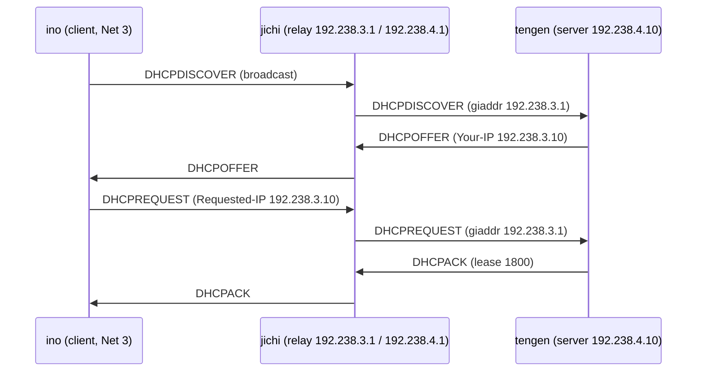

# Jarkom-Modul-3-2026-K-54

| Nama                 | NRP        |
|----------------------|------------|
| Viko Rizky Fauzan    | 5027251017 |
| Sean Arthur Tamajaya | 5027251050 |

## Tabel IP Host

Asumsi prefix kelompok adalah `192.238`. Semua interface internal menggunakan subnet mask `/24`.

| Network | Node | Peran / Fungsi | Alamat IP | Default Gateway |
|---|---|---|---|---|
| **NAT** | `jichi` (`eth0`) | Koneksi WAN ke NAT GNS3 | `192.168.122.100/24` | `192.168.122.1` |
| **Network 1** (`192.238.1.0/24`) | `jichi` (`eth1`) | Gateway DMZ | `192.238.1.1/24` | — |
| Network 1 | `utahime` | DNS Master | `192.238.1.2/24` | `192.238.1.1` |
| Network 1 | `shoko` | DNS Slave | `192.238.1.3/24` | `192.238.1.1` |
| Network 1 | `gojo` | Public Reverse Proxy | `192.238.1.4/24` | `192.238.1.1` |
| **Network 2** (`192.238.2.0/24`) | `jichi` (`eth2`) | Gateway / DHCP Relay Network 2 | `192.238.2.1/24` | — |
| Network 2 | `itadori` | Klien Divisi A (Pool 1 - Dev) | DHCP (`.2.10`–`.2.35`) | `192.238.2.1` |
| Network 2 | `fushiguro` | Klien Divisi A (Pool 1 - Dev) | DHCP (`.2.10`–`.2.35`) | `192.238.2.1` |
| Network 2 | `zenin` | Klien Divisi A (Pool 2 - Support) | DHCP (`.2.70`–`.2.95`) | `192.238.2.1` |
| Network 2 | `okkotsu` | Klien Divisi A (Pool 2 - Support) | DHCP (`.2.70`–`.2.95`) | `192.238.2.1` |
| **Network 3** (`192.238.3.0/24`) | `jichi` (`eth3`) | Gateway / DHCP Relay Network 3 | `192.238.3.1/24` | — |
| Network 3 | `ino` | Klien Divisi B (Short Lease - 30m) | DHCP (`.3.10`–`.3.89`) | `192.238.3.1` |
| Network 3 | `kusakabe` | Klien Divisi B (Short Lease - 30m) | DHCP (`.3.10`–`.3.89`) | `192.238.3.1` |
| Network 3 | `miwa` | Klien Divisi B (Long Lease - 12j) | DHCP (`.3.100`–`.3.199`) | `192.238.3.1` |
| Network 3 | `kugisaki` | Klien Fixed Address | `192.238.3.50/24` (DHCP Fixed) | `192.238.3.1` |
| **Network 4** (`192.238.4.0/24`) | `jichi` (`eth4`) | Gateway Data Center | `192.238.4.1/24` | — |
| Network 4 | `tengen` | DHCP Server Utama | `192.238.4.10/24` | `192.238.4.1` |
| Network 4 | `geto` | Internal Load Balancer | `192.238.4.3/24` | `192.238.4.1` |
| Network 4 | `maki` | Worker Frontend | `192.238.4.2/24` | `192.238.4.1` |
| Network 4 | `panda` | Worker Frontend | `192.238.4.11/24` | `192.238.4.1` |
| Network 4 | `nanami` | Worker API Utama | `192.238.4.12/24` | `192.238.4.1` |
| Network 4 | `todo` | Worker API Utama | `192.238.4.13/24` | `192.238.4.1` |
| Network 4 | `kirara` | Worker API Cadangan | `192.238.4.14/24` | `192.238.4.1` |
| Network 4 | `yaga` | Database Master MariaDB | `192.238.4.20/24` | `192.238.4.1` |
| Network 4 | `inumaki` | Database Slave MariaDB | `192.238.4.21/24` | `192.238.4.1` |

### Rentang DHCP yang disarankan

| Subnet | Alokasi Pool / Scope | Rentang Alamat IP | Pengguna Target | Keterangan / Kebijakan |
|---|---|---|---|---|
| **Network 2** (`192.238.2.0/24`) | Pool 1 (Dev) | `192.238.2.10` – `192.238.2.35` | `itadori`, `fushiguro` | Dibatasi via Class MAC Address |
| | Pool Exclude | `192.238.2.36` – `192.238.2.69` | — | Dikosongkan / Tidak Dialokasikan |
| | Pool 2 (Support) | `192.238.2.70` – `192.238.2.95` | `zenin`, `okkotsu` | Dibatasi via Class MAC Address |
| **Network 3** (`192.238.3.0/24`) | Short Lease Pool | `192.238.3.10` – `192.238.3.89` | `ino`, `kusakabe` | Lease Time: 30 Menit (1800d) |
| | Fixed Address | `192.238.3.50` | `kugisaki` | Reservasi IP Khusus |
| | Long Lease Pool | `192.238.3.100` – `192.238.3.199` | `miwa` | Lease Time: 12 Jam (43200d) |

> Pastikan `192.238.3.50` untuk `kugisaki` dikecualikan dari rentang DHCP jika alamatnya dikonfigurasi manual.

## Soal 1: Membuat jichi menjadi router antara NAT dan empat network internal, lalu menetapkan IP statis pada host sesuai tabel yang telah dibuat.

### Langkah 1: Konfigurasi jichi 

Gunakan script ini ke file /root/jichi-config.sh

```
cat << 'EOF' > /root/jichi-config.sh
#!/bin/sh
set -eu

echo "=== [JICHI] Mengonfigurasi Router & Gateway ==="

# 1. Nyalakan seluruh interface (eth0 - eth4)
ip link set eth0 up
ip link set eth1 up
ip link set eth2 up
ip link set eth3 up
ip link set eth4 up

# 2. Set IP Statis WAN (eth0) langsung ke Subnet NAT GNS3 (Hanya pakai perintah 'ip' bawaan Linux)
ip addr replace 192.168.122.100/24 dev eth0
ip route replace default via 192.168.122.1
printf 'nameserver 192.168.122.1\n' > /etc/resolv.conf

# 3. Tetapkan Alamat IP Gateway internal untuk Network 1 - 4
ip addr replace 192.238.1.1/24 dev eth1
ip addr replace 192.238.2.1/24 dev eth2
ip addr replace 192.238.3.1/24 dev eth3
ip addr replace 192.238.4.1/24 dev eth4

# 4. Aktifkan IPv4 Forwarding
sysctl -w net.ipv4.ip_forward=1 > /dev/null

# 5. Konfigurasi Source NAT (MASQUERADE)
iptables -F
iptables -t nat -F
iptables -t nat -A POSTROUTING -o eth0 -j MASQUERADE

echo "=== [JICHI] Konfigurasi Berhasil Disetup ==="
EOF

chmod +x /root/jichi-config.sh

# Tambahkan ke .bashrc agar PERMANEN & otomatis jalan saat container restart
grep -qxF '/root/jichi-config.sh' /root/.bashrc || echo '/root/jichi-config.sh' >> /root/.bashrc

# Jalankan sekarang
/root/jichi-config.sh
```

Lalu atur file permissionnya:

```
chmod +x /root/jichi-config.sh
/root/jichi-config.sh
```

Agar fowarding tetap aktif setelah di reboot, simpan pengaturannya: 

```
echo '/root/jichi-config.sh' >> /root/.profile
```

### Langkah 2: Tetapkan IP host infrastruktur

Gunakan script ini untuk node selain jichi di network 1 dan 4. Di script tersebut setiap node telah ditetapkan IP nya dan bisa diterapkan ke setiap node agar mengurangi pembuatan script yang hampir sama. Simpan di `/root/node-config.sh`. lalu `chmod +x /root/node-config.sh`.

```
cat << 'EOF' > /root/node-config.sh
#!/bin/sh
set -eu

NODE="$(hostname -s)"
IFACE="eth0"

set_static_ip() {
    IP="$1"
    GATEWAY="$2"

    ip link set "$IFACE" up
    ip addr replace "$IP/24" dev "$IFACE"
    ip route replace default via "$GATEWAY"
    printf 'nameserver 192.168.122.1\n' > /etc/resolv.conf
}

# DNS Resolver awal untuk persiapan instalasi paket
printf 'nameserver 192.168.122.1\n' > /etc/resolv.conf

case "$NODE" in
    # --- Network 1 (DMZ) ---
    utahime)
        set_static_ip 192.238.1.2 192.238.1.1
        ;;
    shoko)
        set_static_ip 192.238.1.3 192.238.1.1
        ;;
    gojo)
        set_static_ip 192.238.1.4 192.238.1.1
        ;;

    # --- Network 4 (Data Center) ---
    tengen)
        # Sesuai instruksi soal No. 2 (192.238.4.10)
        set_static_ip 192.238.4.10 192.238.4.1
        ;;
    maki)
        set_static_ip 192.238.4.2 192.238.4.1
        ;;
    geto)
        set_static_ip 192.238.4.3 192.238.4.1
        ;;
    panda)
        set_static_ip 192.238.4.11 192.238.4.1
        ;;
    nanami)
        set_static_ip 192.238.4.12 192.238.4.1
        ;;
    todo)
        set_static_ip 192.238.4.13 192.238.4.1
        ;;
    kirara)
        set_static_ip 192.238.4.14 192.238.4.1
        ;;
    yaga)
        set_static_ip 192.238.4.20 192.238.4.1
        ;;
    inumaki)
        set_static_ip 192.238.4.21 192.238.4.1
        ;;

    # --- Network 3 (Fixed Address) ---
    kugisaki)
        set_static_ip 192.238.3.50 192.238.3.1
        ;;

    # --- Client DHCP (Divisi A & B) ---
    itadori|fushiguro|zenin|okkotsu|ino|kusakabe|miwa)
        ip link set "$IFACE" up
        ;;

    jichi)
        echo "Untuk jichi, gunakan script /root/jichi-config.sh"
        exit 0
        ;;

    *)
        echo "Hostname tidak dikenali: $NODE"
        exit 1
        ;;
esac

echo "Konfigurasi $NODE selesai."
EOF

chmod +x /root/node-config.sh
```

Agar bisa otomatis ter boot ketika restart daftarkan ke /root/.bashrc dan /root/.profile:

```
# Tambahkan ke .bashrc dan .profile
grep -qxF '/root/node-config.sh' /root/.bashrc || echo '/root/node-config.sh' >> /root/.bashrc
grep -qxF '/root/node-config.sh' /root/.profile || echo '/root/node-config.sh' >> /root/.profile

# Jalankan script-nya sekarang
/root/node-config.sh
```

### Langkah 3: Pengujian di node Tengen

1. Cek IP & Default Route:

   ```
    ip -br addr
    ip route
   ```

   

2. Cek koneksi Internet 
    ```
    ping -c 2 8.8.8.8
    ping -c 2 deb.debian.org
    ```
    

## Soal 2: Mengonfigurasikan Tengen agar dapat mengalokasikan alamat yang membutuhkan konfigurasi dinamis 

### Langkah 1: Pasang dan konfigurasi DHCP server di Tengen

```
apt-get update && apt-get install -y isc-dhcp-server
```


### Langkah 2: Konfigurasi DHCP Server (`/root/tengen-dhcp.sh`);

```
cat << 'EOF' > /root/tengen-dhcp.sh
#!/bin/sh
set -eu

echo "=== Mengonfigurasi isc-dhcp-server di Tengen ==="

# 1. Atur interface listening ke eth0
cat << 'DEFAULT_CONF' > /etc/default/isc-dhcp-server
INTERFACESv4="eth0"
INTERFACESv6=""
DEFAULT_CONF

# 2. Buat konfigurasi utama DHCP Server
cat << 'DHCPD_CONF' > /etc/dhcp/dhcpd.conf
default-lease-time 600;
max-lease-time 7200;
authoritative;

# DNS Name Server
option domain-name-servers 192.238.1.2, 192.238.1.3;

# -------------------------------------------------------------
# Network 4: Data Center (192.238.4.0/24)
# Subnet lokal tempat tengen berada (192.238.4.10)
# Wajib dideklarasikan TANPA pool dinamis (tanpa range)
# agar tidak muncul error "No subnet declaration for eth0"
# -------------------------------------------------------------
subnet 192.238.4.0 netmask 255.255.255.0 {
    option routers 192.238.4.1;
    option broadcast-address 192.238.4.255;
}

# -------------------------------------------------------------
# Network 2: Scope Divisi A (192.238.2.0/24)
# -------------------------------------------------------------
subnet 192.238.2.0 netmask 255.255.255.0 {
    range 192.238.2.10 192.238.2.100;
    option routers 192.238.2.1;
    option broadcast-address 192.238.2.255;
}

# -------------------------------------------------------------
# Network 3: Scope Divisi B (192.238.3.0/24)
# -------------------------------------------------------------
subnet 192.238.3.0 netmask 255.255.255.0 {
    range 192.238.3.10 192.238.3.100;
    option routers 192.238.3.1;
    option broadcast-address 192.238.3.255;
}
DHCPD_CONF

# 3. Uji Sintaks Konfigurasi
/usr/sbin/dhcpd -t -cf /etc/dhcp/dhcpd.conf

# 4. Restart Service DHCP Server
service isc-dhcp-server restart || /etc/init.d/isc-dhcp-server restart || true

echo "=== Konfigurasi Tengen Selesai ==="
EOF

chmod +x /root/tengen-dhcp.sh
/root/tengen-dhcp.sh
```


Agar script diatas bisa berjalan otomatis saat ter reboot:

```
# Tambahkan perintah restart service DHCP di akhir file /root/node-config.sh
echo 'service isc-dhcp-server restart || /etc/init.d/isc-dhcp-server restart || true' >> /root/node-config.sh
```

Bagaimana Cara Kerja Alurnya Saat Reboot?
1. Saat container tengen di-restart, /root/.profile / /root/.bashrc akan mengeksekusi /root/node-config.sh.
2. Script /root/node-config.sh mengatur IP statis 192.238.4.10 dan gateway 192.238.4.1.
3. Setelah IP aktif, baris tambahan di atas akan langsung menyalakan daemon isc-dhcp-server.   

### Langkah 3: Pengujian 

1. Uji Sintaks File Configuration:

```
/usr/sbin/dhcpd -t -cf /etc/dhcp/dhcpd.conf
```


Terlihat bahwa tidak ada error

2. Cek Log / Status Service:

```
service isc-dhcp-server status
```


```
ps aux | grep dhcpd
```
Harus muncul baris proses `/usr/sbin/dhcpd` yang sedang berjalan.


```
/usr/sbin/dhcpd -f -d eth0
```  


## Soal 3: Konfigurasi DHCP Relay di Router `jichi`
jichi bertindak sebagai perantara (relay) yang meneruskan request DHCP dari Network 2 (eth2) dan Network 3 (eth3) menuju DHCP Server tengen (192.238.4.10 via eth4).

### Langkah 1: Konfigurasi Node Jichi 

```
cat << 'EOF' > /root/jichi-config.sh
#!/bin/sh
set -eu

echo "=== [JICHI] Mengonfigurasi Router, NAT, & DHCP Relay ==="

# 1. Aktifkan seluruh interface
ip link set eth0 up
ip link set eth1 up
ip link set eth2 up
ip link set eth3 up
ip link set eth4 up

# 2. IP Statis WAN ke Subnet NAT GNS3
ip addr replace 192.168.122.100/24 dev eth0
ip route replace default via 192.168.122.1
printf 'nameserver 192.168.122.1\n' > /etc/resolv.conf

# 3. IP Gateway Internal
ip addr replace 192.238.1.1/24 dev eth1
ip addr replace 192.238.2.1/24 dev eth2
ip addr replace 192.238.3.1/24 dev eth3
ip addr replace 192.238.4.1/24 dev eth4

# 4. IP Forwarding & Source NAT
sysctl -w net.ipv4.ip_forward=1 > /dev/null
iptables -F
iptables -t nat -F
iptables -t nat -A POSTROUTING -o eth0 -j MASQUERADE

# 5. Instalasi isc-dhcp-relay jika belum terpasang
if ! command -v dhcrelay > /dev/null 2>&1; then
    echo "[*] Mengunduh isc-dhcp-relay..."
    apt-get update && apt-get install -y isc-dhcp-relay
fi

# 6. Konfigurasi /etc/default/isc-dhcp-relay
cat << 'RELAY_CONF' > /etc/default/isc-dhcp-relay
SERVERS="192.238.4.10"
INTERFACES="eth2 eth3 eth4"
OPTIONS=""
RELAY_CONF

# 7. Jalankan Service DHCP Relay
service isc-dhcp-relay restart || /etc/init.d/isc-dhcp-relay restart || true

echo "=== [JICHI] Setup Berhasil Selesai ==="
EOF

chmod +x /root/jichi-config.sh

# Daftarkan ke .profile dan .bashrc agar OTOMATIS RUNNING SAAT REBOOT
grep -qxF '/root/jichi-config.sh' /root/.profile || echo '/root/jichi-config.sh' >> /root/.profile
grep -qxF '/root/jichi-config.sh' /root/.bashrc || echo '/root/jichi-config.sh' >> /root/.bashrc

# Jalankan script sekarang
/root/jichi-config.sh
```

Verifikasi Langkah 1:

```
ps aux | grep dhcrelay
```
Pastikan terlihat proses dhcrelay berjalan mengarah ke 192.238.4.10.


### Langkah 2: Pengujian 

1. Uji DHCP Relay di klien Network 2 dan Network 3

   Itadori (Network 2) & Ino (Network 3):

   ```
    udhcpc -i eth0 -q
   ```
   
   
   

   Cek IP yang diterima:

   ```
    ip -br addr
    ip route
   ```

   

   

2. Cek record lease di DHCP Server (Tengen)

   ```
    cat /var/lib/dhcp/dhcpd.leases
   ```

   

## Soal 4: DHCP Class & Dual Pool di Node

| Nama Node | Kelompok / Class | MAC Address | Rentang IP Pool |
|---|---|---|---|
| **itadori** | Dev (`pool1_dev`) | `02:42:ba:30:f3:00` | `192.238.2.10` – `192.238.2.35` |
| **fushiguro** | Dev (`pool1_dev`) | `02:42:93:96:61:00` | `192.238.2.10` – `192.238.2.35` |
| **zenin** | Support (`pool2_support`) | `02:42:02:87:12:00` | `192.238.2.70` – `192.238.2.95` |
| **okkotsu** | Support (`pool2_support`) | `02:42:89:e7:e4:00` | `192.238.2.70` – `192.238.2.95` |

### Langkah 1: Eksekusi script di Node Tengen

```
cat << 'EOF' > /root/tengen-dhcp.sh
#!/bin/sh
set -eu

echo "=== [TENGEN] Mengonfigurasi DHCP Server dengan Class MAC Address ==="

cat << 'DEFAULT_CONF' > /etc/default/isc-dhcp-server
INTERFACESv4="eth0"
INTERFACESv6=""
DEFAULT_CONF

cat << 'DHCPD_CONF' > /etc/dhcp/dhcpd.conf
default-lease-time 600;
max-lease-time 7200;
authoritative;

option domain-name-servers 192.238.1.2, 192.238.1.3;

# -------------------------------------------------------------
# Kelas Client berdasarkan MAC Address
# -------------------------------------------------------------
class "pool1_dev" {
    match hardware;
}
subclass "pool1_dev" 1:02:42:ba:30:f3:00;
subclass "pool1_dev" 1:02:42:93:96:61:00;

class "pool2_support" {
    match hardware;
}
subclass "pool2_support" 1:02:42:02:87:12:00;
subclass "pool2_support" 1:02:42:89:e7:e4:00;

# -------------------------------------------------------------
# Network 4: Data Center (Subnet Lokal Tengen)
# -------------------------------------------------------------
subnet 192.238.4.0 netmask 255.255.255.0 {
    option routers 192.238.4.1;
    option broadcast-address 192.238.4.255;
}

# -------------------------------------------------------------
# Network 2: Scope Divisi A (Dual Pool dengan Class)
# -------------------------------------------------------------
subnet 192.238.2.0 netmask 255.255.255.0 {
    option routers 192.238.2.1;
    option broadcast-address 192.238.2.255;

    # Pool 1: Dev (Itadori & Fushiguro)
    pool {
        allow members of "pool1_dev";
        range 192.238.2.10 192.238.2.35;
    }

    # Pool 2: Support (Zenin & Okkotsu)
    pool {
        allow members of "pool2_support";
        range 192.238.2.70 192.238.2.95;
    }
}

# -------------------------------------------------------------
# Network 3: Scope Divisi B
# -------------------------------------------------------------
subnet 192.238.3.0 netmask 255.255.255.0 {
    range 192.238.3.10 192.238.3.100;
    option routers 192.238.3.1;
    option broadcast-address 192.238.3.255;
}
DHCPD_CONF

# Validasi sintaks
/usr/sbin/dhcpd -t -cf /etc/dhcp/dhcpd.conf

# Restart Service
service isc-dhcp-server restart || /etc/init.d/isc-dhcp-server restart || true

echo "=== [TENGEN] Setup Soal 4 Selesai ==="
EOF

chmod +x /root/tengen-dhcp.sh

# Daftarkan ke file startup agar otomatis running saat restart
grep -qxF '/root/tengen-dhcp.sh' /root/.profile || echo '/root/tengen-dhcp.sh' >> /root/.profile
grep -qxF '/root/tengen-dhcp.sh' /root/.bashrc || echo '/root/tengen-dhcp.sh' >> /root/.bashrc

# Eksekusi script
/root/tengen-dhcp.sh
```

### Langkah 2: Pengujian di Divisi A 

1. Di itadori atau fushiguro:

   ```
    udhcpc -i eth0 -q
    ip -br addr
   ```
   Harus menerima IP di rentang 192.238.2.10–192.238.2.35.

   

   


2. Di zenin atau okkotsu:

   ```
    udhcpc -i eth0 -q
    ip -br addr
   ```
   Harus menerima IP di rentang 192.238.2.70–192.238.2.95.

   

   

## Soal 5: Mengatur durasi lease di Network 3 menggunakan DHCP Class berdasarkan MAC Address

- Short Lease (30 menit = 1800 detik): Pool 192.238.3.10–192.238.3.89 untuk ino dan kusakabe.   
- Long Lease (12 jam = 43200 detik): Pool 192.238.3.100–192.238.3.199 untuk miwa.
- DHCP Options: DNS 192.238.1.2, 192.238.1.3 dan domain-search.

### Langkah 1: Cek MAC Address Klien Network 3 (kusakabe & miwa) 

```
ip link show eth0
```


  


| Nama Node | Kelompok / Class | MAC Address | Rentang IP Pool | Default / Max Lease Time |
|---|---|---|---|---|
| **ino** | Short Lease (`short_lease`) | `02:42:a5:41:3b:00` | `192.238.3.10` – `192.238.3.89` | 1800 detik (30 menit) |
| **kusakabe** | Short Lease (`short_lease`) | `02:42:89:2f:5f:00` | `192.238.3.10` – `192.238.3.89` | 1800 detik (30 menit) |
| **miwa** | Long Lease (`long_lease`) | `02:42:ea:de:c4:00` | `192.238.3.100` – `192.238.3.199` | 43200 detik (12 jam) |


### Langkah 2:  **Script Akumulatif `/root/tengen-dhcp.sh` di Node `tengen`**

Jalankan seluruh blok kode berikut di terminal node **`tengen`**:

```bash
cat << 'EOF' > /root/tengen-dhcp.sh
#!/bin/sh
set -eu

echo "=== [TENGEN] Mengonfigurasi DHCP Server (Soal 1-5 Akumulatif) ==="

# =========================================================================
# MAC ADDRESS CLIENT NETWORK 3
# =========================================================================
MAC_INO="02:42:a5:41:3b:00"
MAC_KUSAKABE="02:42:89:2f:5f:00"
MAC_MIWA="02:42:ea:de:c4:00"

DOMAIN_NAME="jarkom.com"
# =========================================================================

cat << 'DEFAULT_CONF' > /etc/default/isc-dhcp-server
INTERFACESv4="eth0"
INTERFACESv6=""
DEFAULT_CONF

cat << DHCPD_CONF > /etc/dhcp/dhcpd.conf
default-lease-time 600;
max-lease-time 7200;
authoritative;

# DHCP Options Global (Soal 5)
option domain-name-servers 192.238.1.2, 192.238.1.3;
option domain-name "${DOMAIN_NAME}";
option domain-search "${DOMAIN_NAME}";

# -------------------------------------------------------------
# CLASS DIVISI A - NETWORK 2 (Soal 4)
# -------------------------------------------------------------
class "pool1_dev" {
    match hardware;
}
subclass "pool1_dev" 1:02:42:ba:30:f3:00;
subclass "pool1_dev" 1:02:42:93:96:61:00;

class "pool2_support" {
    match hardware;
}
subclass "pool2_support" 1:02:42:02:87:12:00;
subclass "pool2_support" 1:02:42:89:e7:e4:00;

# -------------------------------------------------------------
# CLASS DIVISI B - NETWORK 3 (Soal 5)
# -------------------------------------------------------------
class "short_lease" {
    match hardware;
}
subclass "short_lease" 1:${MAC_INO};
subclass "short_lease" 1:${MAC_KUSAKABE};

class "long_lease" {
    match hardware;
}
subclass "long_lease" 1:${MAC_MIWA};

# -------------------------------------------------------------
# Network 4: Data Center (Subnet Lokal Tengen)
# -------------------------------------------------------------
subnet 192.238.4.0 netmask 255.255.255.0 {
    option routers 192.238.4.1;
    option broadcast-address 192.238.4.255;
}

# -------------------------------------------------------------
# Network 2: Scope Divisi A (Dual Pool dengan Class - Soal 4)
# -------------------------------------------------------------
subnet 192.238.2.0 netmask 255.255.255.0 {
    option routers 192.238.2.1;
    option broadcast-address 192.238.2.255;

    # Pool 1: Dev (Itadori & Fushiguro)
    pool {
        allow members of "pool1_dev";
        range 192.238.2.10 192.238.2.35;
    }

    # Pool 2: Support (Zenin & Okkotsu)
    pool {
        allow members of "pool2_support";
        range 192.238.2.70 192.238.2.95;
    }
}

# -------------------------------------------------------------
# Network 3: Scope Divisi B (Short & Long Lease Pool - Soal 5)
# -------------------------------------------------------------
subnet 192.238.3.0 netmask 255.255.255.0 {
    option routers 192.238.3.1;
    option broadcast-address 192.238.3.255;

    # Pool Short Lease: Ino & Kusakabe (30 Menit = 1800 detik)
    pool {
        allow members of "short_lease";
        range 192.238.3.10 192.238.3.89;
        default-lease-time 1800;
        max-lease-time 1800;
    }

    # Pool Long Lease: Miwa (12 Jam = 43200 detik)
    pool {
        allow members of "long_lease";
        range 192.238.3.100 192.238.3.199;
        default-lease-time 43200;
        max-lease-time 43200;
    }
}
DHCPD_CONF

# Validasi sintaks
/usr/sbin/dhcpd -t -cf /etc/dhcp/dhcpd.conf

# Restart Service
service isc-dhcp-server restart || /etc/init.d/isc-dhcp-server restart || true

echo "=== [TENGEN] Setup Berhasil Diperbarui ==="
EOF

chmod +x /root/tengen-dhcp.sh

# Garansi Otomatis Reboot
grep -qxF '/root/tengen-dhcp.sh' /root/.profile || echo '/root/tengen-dhcp.sh' >> /root/.profile
grep -qxF '/root/tengen-dhcp.sh' /root/.bashrc || echo '/root/tengen-dhcp.sh' >> /root/.bashrc

# Jalankan script
/root/tengen-dhcp.sh

```

### Langkah 3: Pengujian 

1. Di ino & kusakabe

   ```
    udhcpc -i eth0 -q
   ```
   IP berada di rentang 192.238.3.10 – 192.238.3.89 dengan keterangan lease time 1800.

   

   

    
   
2. Di miwa

   ```
    udhcpc -i eth0 -q
   ```

   

3. Cek DNS & Domain Search pada klien Network 3

   ```
    cat /etc/resolv.conf
   ```

   Menampilkan nameserver 192.238.1.2, nameserver 192.238.1.3, dan search jarkom.com

   


# Laporan Soal 6: DHCP Static Lease Kugisaki (VIP)

## 1. Soal

> **Kugisaki** ditetapkan sebagai personel VIP yang harus mempertahankan alamat yang sama setiap kali terhubung. Buat **DHCP static lease** berdasarkan MAC Address client tersebut dengan **fixed address `[PREFIX IP].3.99`**. Pastikan alamat ini berada di luar seluruh pool dinamis, validasi konfigurasi server, lalu renew lease pada client. Buktikan bahwa alamat yang diterima sesuai dengan reservasi.

Dengan prefix IP `192.238`, fixed address Kugisaki adalah **`192.238.3.99`**.

## 2. Ringkasan

| Item | Keterangan |
|---|---|
| Node server | `tengen` (`192.238.4.10`) |
| Node client | `kugisaki` (Network 3, `192.238.3.0/24`) |
| MAC Address Kugisaki | `02:42:bb:7b:73:00` |
| Fixed address | `192.238.3.99` |
| Hasil | **Berhasil**: Kugisaki menerima `192.238.3.99` sesuai reservasi |

## 3. Konfigurasi Static Lease (di Tengen)

Reservasi dibuat dengan blok `host` di dalam `subnet 192.238.3.0` pada `/etc/dhcp/dhcpd.conf`:

```conf
host kugisaki {
    hardware ethernet 02:42:bb:7b:73:00;
    fixed-address 192.238.3.99;
}
```

### Alamat berada di luar seluruh pool dinamis

Pool dinamis pada Network 3:

| Pool | Range | Mencakup `.3.99`? |
|---|---|---|
| Pool pertama | `192.238.3.10` – `192.238.3.89` | Tidak |
| Pool kedua | `192.238.3.100` – `192.238.3.199` | Tidak |

Alamat `.3.99` berada di celah antara `.89` dan `.100`, sehingga tidak akan pernah dialokasikan secara dinamis ke client lain.

### Validasi dan restart service

```sh
/usr/sbin/dhcpd -t -cf /etc/dhcp/dhcpd.conf
service isc-dhcp-server restart
```

## 4. Pengujian di Client Kugisaki

Perintah di node `kugisaki` untuk renew lease dan memeriksa alamat:

```sh
udhcpc -i eth0 -q
ip -br addr
```

Output:

```text
udhcpc: started, v1.37.0
udhcpc: broadcasting discover
udhcpc: broadcasting select for 192.238.3.99, server 192.238.4.10
udhcpc: lease of 192.238.3.99 obtained from 192.238.4.10, lease time 600
lo               UNKNOWN        127.0.0.1/8 ::1/128
eth0             UNKNOWN        192.238.3.99/24 fe80::42:bbff:fe7b:7300/64
eth1             UNKNOWN        fe80::42:bbff:fe7b:7301/64
eth2             UNKNOWN        fe80::42:bbff:fe7b:7302/64
eth3             UNKNOWN        fe80::42:bbff:fe7b:7303/64
```
Bukti :


## 5. Analisis Bukti

| Bukti | Penjelasan |
|---|---|
| `broadcasting select for 192.238.3.99` | Server menawarkan alamat tepat sesuai `fixed-address` |
| `server 192.238.4.10` | Penawaran berasal dari DHCP Server Tengen |
| `lease of 192.238.3.99 obtained` | Lease berhasil diperoleh client |
| `eth0 ... 192.238.3.99/24` | Alamat benar terpasang pada interface `eth0` |
| `fe80::42:bbff:fe7b:7300` | Link-local IPv6 diturunkan dari MAC `02:42:bb:7b:73:00`, cocok dengan MAC pada blok `host kugisaki` |

## 6. Kesimpulan

1. Static lease dibuat berdasarkan MAC Address Kugisaki (`02:42:bb:7b:73:00`) dengan `fixed-address 192.238.3.99`.
2. Alamat `192.238.3.99` berada di luar seluruh pool dinamis Network 3.
3. Konfigurasi divalidasi dan service DHCP di-restart.
4. Setelah renew lease (`udhcpc -i eth0 -q`), Kugisaki menerima `192.238.3.99` dari `192.238.4.10`, sesuai dengan reservasi.

**Soal 6 terpenuhi.**

# Laporan Soal 7: Verifikasi Konfigurasi Jaringan Client Divisi A dan B
 
## 1. Soal
 
> Setelah aturan alokasi diterapkan, pastikan setiap client menerima konfigurasi jaringan sesuai wilayahnya: subnet mask **255.255.255.0 (/24)**, gateway dan broadcast address yang benar, DNS **[PREFIX IP].1.2** serta **[PREFIX IP].1.3**, dan domain-search yang ditentukan. Periksa IP address dan routing seluruh client Divisi A dan Divisi B, kemudian cocokkan lease dengan **/var/lib/dhcp/dhcpd.leases** pada **tengen**. Pastikan tidak ada alamat yang bertabrakan atau berada di luar kebijakan pool.
 
Dengan prefix IP `192.238`, DNS yang diharapkan adalah `192.238.1.2` dan `192.238.1.3`, dengan domain-search `jarkom.com`.
 
## 2. Ringkasan Hasil
 
| Item | Hasil |
|---|---|
| Jumlah client diuji | 8 (4 Divisi A, 4 Divisi B) |
| DHCP Server | `tengen` (`192.238.4.10`) |
| Subnet mask | `/24` pada seluruh client |
| Gateway | Sesuai wilayah (`.2.1` untuk Divisi A, `.3.1` untuk Divisi B) |
| DNS | `192.238.1.2` dan `192.238.1.3` pada seluruh client |
| Domain-search | `jarkom.com` pada seluruh client |
| Alamat bertabrakan | Tidak ada (8 IP unik) |
| Alamat di luar kebijakan pool | Tidak ada |
 
## 3. Metode Pengujian
 
### 3.1 Di setiap node client
 
Dijalankan pada `itadori`, `fushiguro`, `zenin`, `okkotsu`, `ino`, `kusakabe`, `miwa`, dan `kugisaki`:
 
```sh
# Renew IP Address
udhcpc -i eth0 -q
 
# Cek IP Address & Netmask
ip -br addr
 
# Cek Gateway & Routing
ip route
 
# Cek DNS Server & Search Domain
cat /etc/resolv.conf
```
 
### 3.2 Di node tengen
 
```sh
cat /var/lib/dhcp/dhcpd.leases
```
 
## 4. Tabel Hasil Verifikasi Seluruh Client
 
| Client | Divisi / Wilayah | MAC Address | IP Address Teralokasi | Subnet Mask | Gateway | DNS Server | Domain Search | Tipe Lease / Pool Policy |
|---|---|---|---|---|---|---|---|---|
| **itadori** | Divisi A (Network 2) | `02:42:ba:30:f3:00` | `192.238.2.10` | `/24` (`255.255.255.0`) | `192.238.2.1` | `192.238.1.2`, `192.238.1.3` | `jarkom.com` | Dynamic (`pool1_dev`: 10-35) |
| **fushiguro** | Divisi A (Network 2) | `02:42:93:96:61:00` | `192.238.2.11` | `/24` (`255.255.255.0`) | `192.238.2.1` | `192.238.1.2`, `192.238.1.3` | `jarkom.com` | Dynamic (`pool1_dev`: 10-35) |
| **zenin** | Divisi A (Network 2) | `02:42:02:87:12:00` | `192.238.2.70` | `/24` (`255.255.255.0`) | `192.238.2.1` | `192.238.1.2`, `192.238.1.3` | `jarkom.com` | Dynamic (`pool2_support`: 70-95) |
| **okkotsu** | Divisi A (Network 2) | `02:42:89:e7:e4:00` | `192.238.2.71` | `/24` (`255.255.255.0`) | `192.238.2.1` | `192.238.1.2`, `192.238.1.3` | `jarkom.com` | Dynamic (`pool2_support`: 70-95) |
| **ino** | Divisi B (Network 3) | `02:42:a5:41:3b:00` | `192.238.3.10` | `/24` (`255.255.255.0`) | `192.238.3.1` | `192.238.1.2`, `192.238.1.3` | `jarkom.com` | Short Lease (30m / 1800s) |
| **kusakabe** | Divisi B (Network 3) | `02:42:89:2f:5f:00` | `192.238.3.11` | `/24` (`255.255.255.0`) | `192.238.3.1` | `192.238.1.2`, `192.238.1.3` | `jarkom.com` | Short Lease (30m / 1800s) |
| **miwa** | Divisi B (Network 3) | `02:42:ea:de:c4:00` | `192.238.3.100` | `/24` (`255.255.255.0`) | `192.238.3.1` | `192.238.1.2`, `192.238.1.3` | `jarkom.com` | Long Lease (12h / 43200s) |
| **kugisaki** | Divisi B (Network 3) | `02:42:bb:7b:73:00` | `192.238.3.99` | `/24` (`255.255.255.0`) | `192.238.3.1` | `192.238.1.2`, `192.238.1.3` | `jarkom.com` | VIP Reservation (Static Lease) |
 
## 5. Bukti Per Client
 
### 5.1 Divisi A (Network 2)
 
| Client | Pesan `udhcpc` | Lease time | Route default | Route connected |
|---|---|---|---|---|
| itadori | `lease of 192.238.2.10 obtained from 192.238.4.10` | 593 s | `default via 192.238.2.1 dev eth0` | `192.238.2.0/24 dev eth0 src 192.238.2.10` |
| fushiguro | `lease of 192.238.2.11 obtained from 192.238.4.10` | 600 s | `default via 192.238.2.1 dev eth0` | `192.238.2.0/24 dev eth0 src 192.238.2.11` |
| zenin | `lease of 192.238.2.70 obtained from 192.238.4.10` | 600 s | `default via 192.238.2.1 dev eth0` | `192.238.2.0/24 dev eth0 src 192.238.2.70` |
| okkotsu | `lease of 192.238.2.71 obtained from 192.238.4.10` | 600 s | `default via 192.238.2.1 dev eth0` | `192.238.2.0/24 dev eth0 src 192.238.2.71` |
 
### 5.2 Divisi B (Network 3)
 
| Client | Pesan `udhcpc` | Lease time | Route default | Route connected |
|---|---|---|---|---|
| ino | `lease of 192.238.3.10 obtained from 192.238.4.10` | 1800 s | `default via 192.238.3.1 dev eth0` | `192.238.3.0/24 dev eth0 src 192.238.3.10` |
| kusakabe | `lease of 192.238.3.11 obtained from 192.238.4.10` | 1800 s | `default via 192.238.3.1 dev eth0` | `192.238.3.0/24 dev eth0 src 192.238.3.11` |
| miwa | `lease of 192.238.3.100 obtained from 192.238.4.10` | 43200 s | `default via 192.238.3.1 dev eth0` | `192.238.3.0/24 dev eth0 src 192.238.3.100` |
| kugisaki | `lease of 192.238.3.99 obtained from 192.238.4.10` | 600 s | `default via 192.238.3.1 dev eth0` | `192.238.3.0/24 dev eth0 src 192.238.3.99` |
 
### 5.3 DNS dan domain-search (identik pada seluruh client)
 
```text
search jarkom.com
nameserver 192.238.1.2
nameserver 192.238.1.3
```
 
### 5.4 Contoh output lengkap (client `kugisaki`)
 
```text
udhcpc: started, v1.37.0
udhcpc: broadcasting discover
udhcpc: broadcasting select for 192.238.3.99, server 192.238.4.10
udhcpc: lease of 192.238.3.99 obtained from 192.238.4.10, lease time 600
lo               UNKNOWN        127.0.0.1/8 ::1/128
eth0             UNKNOWN        192.238.3.99/24 fe80::42:bbff:fe7b:7300/64
eth1             UNKNOWN        fe80::42:bbff:fe7b:7301/64
eth2             UNKNOWN        fe80::42:bbff:fe7b:7302/64
eth3             UNKNOWN        fe80::42:bbff:fe7b:7303/64
default via 192.238.3.1 dev eth0 metric 55434
192.238.3.0/24 dev eth0 proto kernel scope link src 192.238.3.99
search jarkom.com
nameserver 192.238.1.2
nameserver 192.238.1.3
```


 
## 6. Pencocokan dengan `/var/lib/dhcp/dhcpd.leases` di Tengen
 
Cuplikan lease dari `tengen`:
 
```text
lease 192.238.2.10 {
  starts 2 2026/10/13 13:26:55;
  ends 2 2026/10/13 13:36:55;
  binding state active;
  hardware ethernet 02:42:ba:30:f3:00;
  set vendor-class-identifier = "udhcp 1.37.0";
}
lease 192.238.2.11 {
  starts 2 2026/10/13 13:27:03;
  ends 2 2026/10/13 13:37:03;
  ...
}
```


 
| Pengecekan | Hasil |
|---|---|
| `lease 192.238.2.10` memiliki `hardware ethernet 02:42:ba:30:f3:00` | Cocok dengan MAC **itadori** |
| `lease 192.238.2.10` berstatus `binding state active` | Lease aktif |
| Durasi `starts` ke `ends` | 10 menit (600 s), sesuai `default-lease-time` Divisi A |
| `lease 192.238.2.11` | Sesuai IP **fushiguro** (urutan kedua di pool `pool1_dev`) |
| `vendor-class-identifier = "udhcp 1.37.0"` | Sesuai versi `udhcpc` di client |
 
Catatan: waktu pada `dhcpd.leases` ditulis dalam UTC (13:26 UTC setara 20:26 WIB). Cuplikan layar hanya menampilkan entri awal file; entri lease client lain dicocokkan melalui pesan `lease of ... obtained from 192.238.4.10` pada masing-masing client.
 
## 7. Pengecekan Tabrakan dan Kebijakan Pool
 
### 7.1 Tidak ada alamat bertabrakan
 
Delapan client menerima delapan alamat berbeda:
 
`192.238.2.10`, `192.238.2.11`, `192.238.2.70`, `192.238.2.71`, `192.238.3.10`, `192.238.3.11`, `192.238.3.99`, `192.238.3.100`.
 
Alamat `192.238.2.x` dan `192.238.3.x` berada pada subnet berbeda, sehingga tidak ada duplikasi dalam satu subnet.
 
### 7.2 Semua alamat sesuai kebijakan pool
 
| Client | IP | Pool kebijakan | Range | Dalam range? |
|---|---|---|---|---|
| itadori | `192.238.2.10` | `pool1_dev` | `.2.10` – `.2.35` | Ya |
| fushiguro | `192.238.2.11` | `pool1_dev` | `.2.10` – `.2.35` | Ya |
| zenin | `192.238.2.70` | `pool2_support` | `.2.70` – `.2.95` | Ya |
| okkotsu | `192.238.2.71` | `pool2_support` | `.2.70` – `.2.95` | Ya |
| ino | `192.238.3.10` | `short_lease` | `.3.10` – `.3.89` | Ya |
| kusakabe | `192.238.3.11` | `short_lease` | `.3.10` – `.3.89` | Ya |
| miwa | `192.238.3.100` | `long_lease` | `.3.100` – `.3.199` | Ya |
| kugisaki | `192.238.3.99` | Reservasi (`host`) | di luar semua pool | Ya (static lease) |
 
Tidak ada client yang menerima alamat di luar kebijakan pool-nya. Setiap client Divisi A masuk ke pool sesuai class-nya, dan lease time Divisi B sesuai kebijakan (1800 s untuk short lease, 43200 s untuk long lease).

# Laporan Soal 8: Packet Capture Proses DHCP (DORA)
 
## 1. Soal
 
> Sebelum Curtain dibuka kembali, buktikan bahwa proses pemberian alamat berjalan sesuai protokol. Lakukan packet capture saat salah satu client **Network 2** atau **Network 3** meminta lease baru. Gunakan **tcpdump** pada **tengen** atau jalur menuju Data Center untuk menunjukkan urutan **DHCPDISCOVER → DHCPOFFER → DHCPREQUEST → DHCPACK**. Identifikasi alamat server, alamat yang diberikan, lease time, dan field **giaddr**. Pastikan nilai **giaddr** sesuai dengan interface **jichi** yang menerima request dari subnet client.
 
## 2. Ringkasan Hasil
 
| Item | Hasil |
|---|---|
| Client yang diuji (capture) | `ino` (Network 3), MAC `02:42:a5:41:3b:00` |
| Client pembanding (log client) | `itadori` (Network 2) |
| Titik capture | `tengen`, interface `eth0` |
| Transaction ID (xid) | `0x8a25a829` |
| Alamat DHCP Server (Server-ID) | `192.238.4.10` |
| Alamat yang diberikan (Your-IP) | `192.238.3.10` |
| Lease time | `1800` detik (30 menit) |
| giaddr | `192.238.3.1` (interface jichi di Network 3) |
| Jumlah hop relay | `1` |
 
## 3. Langkah Pengujian
 
### Langkah 1: jalankan packet capture di `tengen`
 
```sh
tcpdump -i eth0 -n -v "port 67 or port 68"
```
 
Filter `port 67 or port 68` menangkap seluruh trafik DHCP (port 67 untuk server, port 68 untuk client).
 
### Langkah 2: minta lease baru dari client
 
Pada node `ino` (Network 3):
 
```sh
udhcpc -i eth0 -n
```
 
Output client:
 
```text
udhcpc: started, v1.37.0
udhcpc: broadcasting discover
udhcpc: broadcasting select for 192.238.3.10, server 192.238.4.10
udhcpc: lease of 192.238.3.10 obtained from 192.238.4.10, lease time 1800
```
 
Sebagai pembanding, hasil yang sama pada node `itadori` (Network 2):
 
```text
udhcpc: started, v1.37.0
udhcpc: broadcasting discover
udhcpc: broadcasting select for 192.238.2.10, server 192.238.4.10
udhcpc: lease of 192.238.2.10 obtained from 192.238.4.10, lease time 600
```


 
## 4. Urutan Paket Hasil Capture di `tengen`
 
Seluruh paket memiliki `xid 0x8a25a829` dan Client MAC `02:42:a5:41:3b:00`, sehingga terbukti satu transaksi DHCP yang sama.
 
| No | Waktu | Pesan DHCP | Arah (src → dst) | Keterangan |
|---|---|---|---|---|
| 1 | (sebelum 21:52:24.436977) | **DISCOVER** | client → broadcast, diteruskan relay | Terlihat di log client: `broadcasting discover` |
| 2 | 21:52:24.436977 | **OFFER** | `192.238.4.10.67 > 192.238.3.1.67` | Server menawarkan `192.238.3.10` |
| 3 | 21:52:24.443120 | **REQUEST** | `192.238.4.1.67 > 192.238.4.10.67` | Client meminta `192.238.3.10` |
| 4 | 21:52:24.444150 | **ACK** | `192.238.4.10.67 > 192.238.3.1.67` | Server mengonfirmasi lease |
 

 
## 5. Detail Setiap Paket
 
### 5.1 DHCPOFFER (21:52:24.436977)
 
```text
192.238.4.10.67 > 192.238.3.1.67: BOOTP/DHCP, Reply, length 300, hops 1, xid 0x8a25a829
    Your-IP 192.238.3.10
    Gateway-IP 192.238.3.1
    Client-Ethernet-Address 02:42:a5:41:3b:00
    DHCP-Message (53): Offer
    Server-ID (54): 192.238.4.10
    Lease-Time (51): 1800
    Subnet-Mask (1): 255.255.255.0
    Default-Gateway (3): 192.238.3.1
    Domain-Name-Server (6): 192.238.1.2,192.238.1.3
    Domain-Name (15): "jarkom.com"
    BR (28): 192.238.3.255
```


 
### 5.2 DHCPREQUEST (21:52:24.443120)
 
```text
192.238.4.1.67 > 192.238.4.10.67: BOOTP/DHCP, Request from 02:42:a5:41:3b:00, length 300, hops 1, xid 0x8a25a829
    Gateway-IP 192.238.3.1
    Client-Ethernet-Address 02:42:a5:41:3b:00
    DHCP-Message (53): Request
    Requested-IP (50): 192.238.3.10
    Server-ID (54): 192.238.4.10
    Vendor-Class (60): "udhcp 1.37.0"
    Client-ID (61): ether 02:42:a5:41:3b:00
```


 
### 5.3 DHCPACK (21:52:24.444150)
 
```text
192.238.4.10.67 > 192.238.3.1.67: BOOTP/DHCP, Reply, length 300, hops 1, xid 0x8a25a829
    Your-IP 192.238.3.10
    Gateway-IP 192.238.3.1
    Client-Ethernet-Address 02:42:a5:41:3b:00
    DHCP-Message (53): ACK
    Server-ID (54): 192.238.4.10
    Lease-Time (51): 1800
    Subnet-Mask (1): 255.255.255.0
    Default-Gateway (3): 192.238.3.1
    Domain-Name-Server (6): 192.238.1.2,192.238.1.3
    Domain-Name (15): "jarkom.com"
    BR (28): 192.238.3.255
```


 
## 6. Identifikasi Field yang Diminta
 
| Field | Nilai | Sumber bukti |
|---|---|---|
| Alamat server | `192.238.4.10` | `Server-ID (54)` pada Offer, Request, dan ACK; sumber paket Offer/ACK |
| Alamat yang diberikan | `192.238.3.10` | `Your-IP` pada Offer dan ACK; `Requested-IP (50)` pada Request |
| Lease time | `1800` detik (30 menit) | `Lease-Time (51)` pada Offer dan ACK |
| giaddr | `192.238.3.1` | Field `Gateway-IP` pada Offer, Request, dan ACK |
| Hop relay | `1` | `hops 1` pada seluruh paket |
 
## 7. Validasi giaddr terhadap Interface jichi
 
| Pengecekan | Hasil |
|---|---|
| `giaddr` pada paket | `192.238.3.1` |
| Gateway Network 3 | `192.238.3.1` (`Default-Gateway (3)` dan `default via 192.238.3.1` di client) |
| Subnet client `ino` | `192.238.3.0/24` |
| Paket Request dari relay menuju server | Bersumber `192.238.4.1`, yaitu sisi jichi yang menghadap Data Center |
| Reply server dikirim ke | `192.238.3.1:67`, yaitu alamat giaddr |
 
`giaddr` bernilai `192.238.3.1`, yaitu alamat interface jichi pada subnet client (Network 3). Hal ini sesuai dengan prinsip relay DHCP: relay mengisi `giaddr` dengan alamat interface yang menerima broadcast client, lalu server memilih scope `192.238.3.0/24` berdasarkan nilai itu dan membalas ke alamat tersebut. Pemilihan alamat `192.238.3.10` dari pool Network 3 dan lease time `1800` detik (kebijakan short lease untuk `ino`) menunjukkan server membaca `giaddr` dengan benar.

# Laporan Soal 9: Simulasi Gangguan DHCP Relay pada Jichi
 
## 1. Soal
 
> Sebuah gangguan memutus jalur relay dan membuat permintaan alamat tidak sampai ke Data Center. Hentikan service **DHCP Relay** pada **jichi**, lalu paksa salah satu client di Network 2 atau Network 3 meminta lease baru dan catat gejalanya. Pulihkan service relay, ulangi permintaan DHCP, lalu buktikan bahwa client kembali memperoleh alamat dari pool yang benar dengan gateway semula.
 
## 2. Ringkasan Hasil
 
| Item | Hasil |
|---|---|
| Node yang diganggu | `jichi` (router dan DHCP Relay) |
| Client yang diuji | `itadori` (Network 2) dan `ino` (Network 3) |
| Gejala saat relay mati | Client mengirim `DISCOVER` berulang, lalu gagal: `udhcpc failed to get a DHCP lease` |
| Setelah relay dipulihkan | Client kembali mendapat lease dari server `192.238.4.10` |
| itadori | `192.238.2.10/24`, gateway `192.238.2.1`, pool `pool1_dev`, lease 470 s |
| ino | `192.238.3.10/24`, gateway `192.238.3.1`, pool `short_lease`, lease 1800 s |
| Gateway setelah pemulihan | Sama dengan sebelum gangguan |
 
## 3. Latar Belakang Singkat
 
Client di Network 2 dan Network 3 berada di subnet berbeda dari DHCP Server `tengen` (`192.238.4.10`, Network 4). Paket `DHCPDISCOVER` bersifat broadcast dan tidak diteruskan oleh router. Karena itu dibutuhkan **DHCP Relay** di `jichi`, yang menerima broadcast client lalu meneruskannya secara unicast ke server dengan mengisi field `giaddr`. Jika relay mati, permintaan client tidak pernah sampai ke server.
 
## 4. Fase 1: Menghentikan DHCP Relay di Jichi
 
Perintah di node `jichi`:
 
```sh
service isc-dhcp-relay stop || pkill -9 dhcrelay
```


 
Perintah ini menghentikan service relay lewat `service`, dan jika gagal, mematikan paksa proses `dhcrelay` dengan `pkill -9`. Perintah selesai tanpa pesan error (prompt kembali dengan normal).
 
## 5. Fase 2: Gejala Saat Relay Mati
 
Client dipaksa meminta lease baru dengan `-n` (keluar jika lease tidak didapat):
 
```sh
udhcpc -i eth0 -n
```
 
### 5.1 Output `itadori` (Network 2)
 
```text
itadori:~# udhcpc -i eth0 -n
udhcpc: started, v1.37.0
udhcpc: broadcasting discover
udhcpc: broadcasting discover
udhcpc: broadcasting discover
udhcpc: broadcasting discover
udhcpc: broadcasting discover
udhcpc failed to get a DHCP lease
udhcpc: no lease, failing
```


 
### 5.2 Output `ino` (Network 3)
 
```text
ino:~# udhcpc -i eth0 -n
udhcpc: started, v1.37.0
udhcpc: broadcasting discover
udhcpc: broadcasting discover
udhcpc: broadcasting discover
udhcpc: broadcasting discover
udhcpc: broadcasting discover
udhcpc failed to get a DHCP lease
udhcpc: no lease, failing
```


 
### 5.3 Pencatatan gejala
 
| Gejala | Penjelasan |
|---|---|
| `broadcasting discover` terulang 5 kali | Client terus mengirim `DISCOVER` tetapi tidak pernah menerima `OFFER` |
| Tidak ada baris `broadcasting select` | Tidak ada tawaran alamat dari server, sehingga tahap `REQUEST` tidak pernah terjadi |
| `udhcpc failed to get a DHCP lease` | Client menyerah setelah percobaan habis |
| `udhcpc: no lease, failing` | Tidak ada lease yang diperoleh; client tidak mendapat IP |
| Terjadi pada kedua network | Gangguan ada pada jalur bersama (jichi), bukan pada satu client atau satu subnet saja |
 
## 6. Fase 3: Memulihkan DHCP Relay
 
Perintah di node `jichi`:
 
```sh
bash jichi-config.sh
```
 
Output:
 
```text
=== [JICHI] Mengonfigurasi Router, NAT, & DHCP Relay ===
start-stop-daemon: warning: failed to kill 535: No such process
Requesting: eth2 as upstream: Y downstream: Y
Requesting: eth3 as upstream: Y downstream: Y
Requesting: eth4 as upstream: Y downstream: Y
=== [JICHI] Setup Berhasil Selesai ===
```


 
| Baris output | Arti |
|---|---|
| `failed to kill 535: No such process` | Proses `dhcrelay` lama (PID 535) sudah tidak berjalan, sesuai kondisi setelah relay dihentikan pada Fase 1 |
| `Requesting: eth2/eth3/eth4 ... upstream: Y downstream: Y` | `dhcrelay` aktif kembali dan mendengarkan pada tiga interface |
| `Setup Berhasil Selesai` | Skrip konfigurasi (router, NAT, DHCP Relay) selesai dijalankan |
 
## 7. Fase 4: Bukti Pemulihan
 
Client mengulangi permintaan DHCP:
 
```sh
udhcpc -i eth0 -q
ip -br addr
ip route
```
 
### 7.1 Output `itadori` (Network 2)
 
```text
udhcpc: started, v1.37.0
udhcpc: broadcasting discover
udhcpc: broadcasting select for 192.238.2.10, server 192.238.4.10
udhcpc: lease of 192.238.2.10 obtained from 192.238.4.10, lease time 470
lo               UNKNOWN        127.0.0.1/8 ::1/128
eth0             UNKNOWN        192.238.2.10/24 fe80::42:baff:fe30:f300/64
default via 192.238.2.1 dev eth0 metric 56257
192.238.2.0/24 dev eth0 proto kernel scope link src 192.238.2.10
```


 
### 7.2 Output `ino` (Network 3)
 
```text
udhcpc: started, v1.37.0
udhcpc: broadcasting discover
udhcpc: broadcasting select for 192.238.3.10, server 192.238.4.10
udhcpc: lease of 192.238.3.10 obtained from 192.238.4.10, lease time 1800
lo               UNKNOWN        127.0.0.1/8 ::1/128
eth0             UNKNOWN        192.238.3.10/24 fe80::42:a5ff:fe41:3b00/64
default via 192.238.3.1 dev eth0 metric 56270
192.238.3.0/24 dev eth0 proto kernel scope link src 192.238.3.10
```


## 8. Perbandingan Sebelum, Saat, dan Setelah Gangguan
 
| Client | Sebelum gangguan (Soal 7) | Saat relay mati | Setelah relay dipulihkan |
|---|---|---|---|
| itadori | `192.238.2.10`, gw `192.238.2.1` | Gagal, tidak ada lease | `192.238.2.10/24`, gw `192.238.2.1` |
| ino | `192.238.3.10`, gw `192.238.3.1` | Gagal, tidak ada lease | `192.238.3.10/24`, gw `192.238.3.1` |
 
### Validasi pool dan kebijakan
 
| Client | IP | Pool yang benar | Range | Lease time | Sesuai? |
|---|---|---|---|---|---|
| itadori | `192.238.2.10` | `pool1_dev` | `.2.10` – `.2.35` | 470 s (sisa dari 600 s) | Ya |
| ino | `192.238.3.10` | `short_lease` | `.3.10` – `.3.89` | 1800 s | Ya |
 
Lease time `470` pada itadori lebih kecil dari 600 karena server masih menyimpan lease aktif sebelumnya untuk MAC yang sama, sehingga yang diberikan adalah sisa waktu lease. Hal serupa terlihat pada Soal 7 (593 s).
 
## 9. Analisis
 
| Pertanyaan | Jawaban | Bukti |
|---|---|---|
| Apa dampak relay mati? | Client di Network 2 dan 3 tidak bisa mendapat IP | Hanya `broadcasting discover`, lalu `failed to get a DHCP lease` |
| Mengapa gagal? | Broadcast `DISCOVER` tidak diteruskan ke Network 4 tanpa relay, sehingga tidak ada `OFFER` | Tidak ada baris `broadcasting select` |
| Apakah relay berhasil dipulihkan? | Ya | Output `Requesting: ... upstream: Y downstream: Y` dan `Setup Berhasil Selesai` |
| Apakah client kembali mendapat lease? | Ya, dari server `192.238.4.10` | `lease of ... obtained from 192.238.4.10` |
| Apakah pool benar? | Ya | `192.238.2.10` (pool1_dev) dan `192.238.3.10` (short_lease) |
| Apakah gateway semula? | Ya | `default via 192.238.2.1` dan `default via 192.238.3.1` |

# Laporan Soal 10: Verifikasi Ketahanan Layanan DHCP Setelah Restart
 
## 1. Soal
 
> Setelah gangguan Shibuya tertangani, pastikan pemulihan bertahan setelah restart. Aktifkan autostart **DHCP Server** pada **tengen** dan **DHCP Relay** pada **jichi**, lalu restart kedua node. Verifikasi status layanan, IP, gateway, lease, dan konektivitas client Network 2–3. Pastikan kebijakan Pool 1, Pool 2, short lease, long lease, dan fixed address tetap berlaku.
 
## 2. Ringkasan Hasil
 
| Item | Hasil |
|---|---|
| DHCP Server (`tengen`) | Aktif setelah restart: `dhcpd is running` |
| DHCP Relay (`jichi`) | Aktif setelah restart: proses `dhcrelay` berjalan sejak boot (PID 127, mulai 22:37) |
| NAT (`jichi`) | Aturan `MASQUERADE` pada `eth0` tetap ada |
| Client Network 2 (`itadori`) | `192.238.2.10/24`, lease 600 s, server `192.238.4.10` |
| Client Network 3 (`ino`) | `192.238.3.10/24`, lease 1800 s, server `192.238.4.10` |
| Alamat setelah restart | Sama dengan sebelum restart (konsisten dengan Soal 7) |
 
## 3. Topologi (GNS3, proyek K-54-MODUL-3)
 
Dari tangkapan layar GNS3, `jichi` berperan sebagai router pusat dengan interface berikut:
 
| Interface jichi | Terhubung ke | Isi segmen |
|---|---|---|
| `eth0` | `NAT1` | Jalur keluar (NAT) |
| `eth1` | `Switch1` | `utahime`, `shoko`, `gojo` (di luar cakupan soal ini) |
| `eth2` | `Switch2` → `Switch3`, `Switch9` | **Network 2**: `itadori`, `fushiguro`, `zenin`, `okkotsu` |
| `eth3` | `Switch4` → `Switch5`, `Switch8` | **Network 3**: `ino`, `kusakabe`, `kugisaki`, `miwa` |
| `eth4` | `Switch6` → `Switch7`, `Switch10` | **Network 4 (Data Center)**: `tengen` dan node lain |
 
Hal ini sesuai dengan argumen `dhcrelay -i eth2 -i eth3 -i eth4`: relay mendengarkan di Network 2 dan 3 (sisi client) serta Network 4 (sisi server), lalu meneruskan ke `192.238.4.10`.
 
## 4. Mekanisme Autostart
 
| Node | Mekanisme | Bukti |
|---|---|---|
| `tengen` | Skrip `/root/tengen-dhcp.sh` didaftarkan ke `/root/.profile` dan `/root/.bashrc`, sehingga konfigurasi dan service DHCP dijalankan ulang setiap node dinyalakan | Isi skrip `tengen-dhcp.sh` (baris `grep -qxF ... >> /root/.profile` dan `/root/.bashrc`) |
| `jichi` | Skrip `jichi-config.sh` (router, NAT, DHCP Relay) | Proses `dhcrelay` dan aturan NAT aktif setelah restart |
 
Pada `tengen`, skrip menjalankan:
 
```sh
grep -qxF '/root/tengen-dhcp.sh' /root/.profile || echo '/root/tengen-dhcp.sh' >> /root/.profile
grep -qxF '/root/tengen-dhcp.sh' /root/.bashrc  || echo '/root/tengen-dhcp.sh' >> /root/.bashrc
```
 
Selain itu skrip memvalidasi sintaks (`dhcpd -t`) dan me-restart `isc-dhcp-server` pada setiap eksekusi.
 
## 5. Verifikasi Status Layanan Setelah Restart
 
### 5.1 DHCP Server di `tengen`
 
```sh
service isc-dhcp-server status || ps aux | grep dhcpd
```
 
```text
Status of ISC DHCPv4 server: dhcpd is running.
```


 
### 5.2 DHCP Relay di `jichi`
 
```sh
ps aux | grep dhcrelay
```
 
```text
root   127  0.0  0.0  5992  3200 ?      Ss  22:37  0:00 /usr/sbin/dhcrelay -q -i eth2 -i eth3 -i eth4 192.238.4.10
root   130  0.0  0.0  3500  1792 pts/0  S+  22:37  0:00 grep dhcrelay
```


 
| Bagian output | Arti |
|---|---|
| `/usr/sbin/dhcrelay` | Proses relay berjalan |
| `-i eth2 -i eth3 -i eth4` | Mendengarkan pada Network 2, Network 3, dan Network 4 |
| `192.238.4.10` | Server tujuan relay, yaitu `tengen` |
| PID `127` dan waktu mulai `22:37` | PID rendah dengan waktu mulai yang sama dengan proses `grep` (PID 130), menunjukkan relay dijalankan otomatis saat node baru menyala |
 
### 5.3 NAT di `jichi`
 
```sh
iptables -t nat -L -n -v
```
 
```text
Chain POSTROUTING (policy ACCEPT 0 packets, 0 bytes)
 pkts bytes target      prot opt in  out   source     destination
    0     0 MASQUERADE  all  --  *   eth0  0.0.0.0/0  0.0.0.0/0
```


 
Aturan `MASQUERADE` pada `eth0` (jalur ke `NAT1`) masih ada setelah restart, sehingga konfigurasi router jichi ikut pulih.
 
## 6. Verifikasi Lease dan IP Client Setelah Restart
 
Pada setiap client dijalankan:
 
```sh
udhcpc -i eth0 -q && ip -br addr
```
 
### 6.1 `itadori` (Network 2)
 
```text
udhcpc: started, v1.37.0
udhcpc: broadcasting discover
udhcpc: broadcasting select for 192.238.2.10, server 192.238.4.10
udhcpc: lease of 192.238.2.10 obtained from 192.238.4.10, lease time 600
lo      UNKNOWN   127.0.0.1/8 ::1/128
eth0    UNKNOWN   192.238.2.10/24 fe80::42:baff:fe30:f300/64
```


 
### 6.2 `ino` (Network 3)
 
```text
udhcpc: started, v1.37.0
udhcpc: broadcasting discover
udhcpc: broadcasting select for 192.238.3.10, server 192.238.4.10
udhcpc: lease of 192.238.3.10 obtained from 192.238.4.10, lease time 1800
lo      UNKNOWN   127.0.0.1/8 ::1/128
eth0    UNKNOWN   192.238.3.10/24 fe80::42:a5ff:fe41:3b00/64
```


 
| Client | IP | Server | Lease | Pool/kebijakan | Sesuai? |
|---|---|---|---|---|---|
| itadori | `192.238.2.10/24` | `192.238.4.10` | 600 s | Pool 1 (`pool1_dev`, `.2.10` – `.2.35`) | Ya |
| ino | `192.238.3.10/24` | `192.238.4.10` | 1800 s | Short lease (`.3.10` – `.3.89`, 30 menit) | Ya |
 
## 7. Bukti Konektivitas Jalur DHCP
 
Client di Network 2 dan Network 3 mendapat lease dari server di Network 4 (`192.238.4.10`). Hal ini hanya bisa terjadi jika seluruh rantai berikut berfungsi setelah restart:
 
1. `dhcrelay` di `jichi` menerima broadcast client pada `eth2` / `eth3`.
2. Relay meneruskan paket ke `192.238.4.10` melalui `eth4`.
3. `dhcpd` di `tengen` memilih scope berdasarkan `giaddr` dan membalas lewat relay.

# Laporan Soal 11: DNS Master–Slave dengan BIND9 (jujutsu.k54.com)
 
## 1. Soal
 
> Utahime dan Shoko ditugaskan membangun sistem penamaan domain resmi agar seluruh pos tidak perlu menghafal alamat IP mentah. Konfigurasikan BIND9 pada **utahime** sebagai **DNS Master** dan **shoko** sebagai **DNS Slave** untuk mengelola domain **jujutsu.<xxxx>.com**. Atur SOA record, NS delegasi untuk kedua server, dan terapkan **allow-transfer** dari Master ke Slave. Pastikan file zona berhasil tersinkronisasi otomatis ke shoko saat nomor serial di utahime dinaikkan, lalu buktikan dengan melakukan query **dig** ke kedua server dari salah satu client.
 
Dengan `<xxxx>` = `k54`, domain yang dikelola adalah **`jujutsu.k54.com`**.
 
## 2. Ringkasan Hasil
 
| Item | Hasil |
|---|---|
| Domain | `jujutsu.k54.com` |
| DNS Master | `utahime` (`192.238.1.2`) |
| DNS Slave | `shoko` (`192.238.1.3`) |
| Software | BIND9 (`named`) |
| Client uji | `itadori` (Network 2), `dig` 9.20.26 |
| Serial awal | `2026101301` (sama di Master dan Slave) |
| Serial setelah dinaikkan | `2026101302` (Slave ikut berubah otomatis) |
| `allow-transfer` | `{ 192.238.1.3; }` (hanya shoko) |
 
Alamat `192.238.1.2` dan `192.238.1.3` sama dengan DNS server yang dibagikan DHCP kepada client (Soal 5 dan 7). Pada topologi GNS3, `utahime` dan `shoko` berada pada `Switch1` yang terhubung ke `eth1` jichi.
 
 
## 4. Konfigurasi DNS Master (utahime)
 
Skrip: `/root/utahime-dns.sh`
 
### 4.1 Deklarasi zona (`/etc/bind/named.conf.local`)
 
```conf
zone "jujutsu.k54.com" {
    type master;
    file "/etc/bind/jujutsu/jujutsu.k54.com";
    allow-transfer { 192.238.1.3; };
    also-notify { 192.238.1.3; };
};
```
 
| Direktif | Fungsi |
|---|---|
| `type master` | utahime adalah sumber data zona |
| `allow-transfer { 192.238.1.3; }` | Hanya shoko yang boleh mengambil file zona |
| `also-notify { 192.238.1.3; }` | Memberi tahu shoko begitu zona berubah, sehingga sinkronisasi tidak menunggu interval refresh |
 
### 4.2 File zona (`/etc/bind/jujutsu/jujutsu.k54.com`)
 
```dns
$TTL    604800
@       IN      SOA     utahime.jujutsu.k54.com. root.jujutsu.k54.com. (
                        2026101301 ; Serial YYYYMMDDNN
                            604800 ; Refresh (1 minggu)
                             86400 ; Retry (1 hari)
                           2419200 ; Expire (4 minggu)
                            604800 ) ; Negative Cache TTL
 
; Name Server Delegation (NS Record)
@       IN      NS      utahime.jujutsu.k54.com.
@       IN      NS      shoko.jujutsu.k54.com.
 
; A Record untuk Name Server
utahime IN      A       192.238.1.2
shoko   IN      A       192.238.1.3
```
 
### 4.3 Penjelasan SOA
 
| Field | Nilai | Arti |
|---|---|---|
| MNAME | `utahime.jujutsu.k54.com.` | Name server utama (Master) |
| RNAME | `root.jujutsu.k54.com.` | Kontak administrator |
| Serial | `2026101301` | Versi zona, format `YYYYMMDDNN` (13 Okt 2026, revisi 01) |
| Refresh | 604800 | Slave mengecek serial setiap 1 minggu jika tidak ada NOTIFY |
| Retry | 86400 | Interval ulang jika refresh gagal |
| Expire | 2419200 | Slave berhenti menjawab jika Master tidak terjangkau 4 minggu |
| Negative Cache TTL | 604800 | Lama cache jawaban negatif |
 
### 4.4 NS delegasi untuk kedua server
 
Terdapat dua record `NS` (`utahime` dan `shoko`) beserta `A` record untuk keduanya, sehingga kedua server terdaftar sebagai name server resmi zona.
 
### 4.5 Validasi dan restart
 
Skrip menjalankan `named-checkconf` dan `named-checkzone jujutsu.k54.com /etc/bind/jujutsu/jujutsu.k54.com`, lalu `rndc reload` (cadangan: `pkill -9 named` lalu `named -u bind`). Skrip juga didaftarkan ke `/root/.profile` dan `/root/.bashrc` agar otomatis berjalan setelah node dinyalakan ulang.
 
## 5. Konfigurasi DNS Slave (shoko)
 
Skrip: `/root/shoko-dns.sh`
 
```conf
zone "jujutsu.k54.com" {
    type slave;
    file "/var/lib/bind/jujutsu.k54.com.saved";
    masters { 192.238.1.2; };
};
```
 
| Direktif | Fungsi |
|---|---|
| `type slave` | shoko menerima salinan zona dari Master |
| `masters { 192.238.1.2; }` | Sumber zona adalah utahime |
| `file ".../jujutsu.k54.com.saved"` | Lokasi file zona hasil transfer di shoko |
 
Skrip menjalankan `named-checkconf`, me-restart BIND9, dan juga didaftarkan ke `.profile` dan `.bashrc` untuk autostart.
 
## 6. Pengujian dari Client `itadori`
 
### 6.1 Query ke DNS Master (`192.238.1.2`)
 
```sh
dig @192.238.1.2 jujutsu.k54.com SOA +short
dig @192.238.1.2 jujutsu.k54.com NS
```
 
Output SOA:
 
```text
utahime.jujutsu.k54.com. root.jujutsu.k54.com. 2026101301 604800 86400 2419200 604800
```
 
Header output NS:
 
```text
; <<>> DiG 9.20.26 <<>> @192.238.1.2 jujutsu.k54.com NS
;; ->>HEADER<<- opcode: QUERY, status: NOERROR, id: 63230
;; flags: qr aa rd; QUERY: 1, ANSWER: 2, AUTHORITY: 0, ADDITIONAL: 3
;; WARNING: recursion requested but not available
```


 
### 6.2 Query ke DNS Slave (`192.238.1.3`)
 
```sh
dig @192.238.1.3 jujutsu.k54.com SOA +short
dig @192.238.1.3 jujutsu.k54.com NS
```
 
Output SOA:
 
```text
utahime.jujutsu.k54.com. root.jujutsu.k54.com. 2026101301 604800 86400 2419200 604800
```
 
Header output NS:
 
```text
; <<>> DiG 9.20.26 <<>> @192.238.1.3 jujutsu.k54.com NS
;; ->>HEADER<<- opcode: QUERY, status: NOERROR, id: 62683
;; flags: qr aa rd; QUERY: 1, ANSWER: 2, AUTHORITY: 0, ADDITIONAL: 3
;; WARNING: recursion requested but not available
```


 
### 6.3 Perbandingan Master dan Slave (serial awal)
 
| Parameter | Master (`192.238.1.2`) | Slave (`192.238.1.3`) |
|---|---|---|
| SOA MNAME | `utahime.jujutsu.k54.com.` | `utahime.jujutsu.k54.com.` |
| Serial | `2026101301` | `2026101301` |
| Status | `NOERROR` | `NOERROR` |
| Flag `aa` (authoritative) | Ada | Ada |
| Jumlah jawaban NS | 2 | 2 |
 
Flag `aa` pada Slave menunjukkan shoko menjawab sebagai server otoritatif dengan data zona yang sudah ia terima, yaitu zone transfer pertama berhasil. Peringatan `recursion requested but not available` wajar, karena kedua server hanya otoritatif untuk zona ini dan tidak menyediakan rekursi.
 
## 7. Uji Sinkronisasi Otomatis (Kenaikan Serial)
 
### 7.1 Menaikkan serial di utahime
 
```sh
sed -i 's/2026101301/2026101302/g' /etc/bind/jujutsu/jujutsu.k54.com
rndc reload || pkill -9 named && named -u bind
rndc notify jujutsu.k54.com
```
 
Output:
 
```text
server reload successful
zone notify queued
```


 
| Langkah | Fungsi |
|---|---|
| `sed -i ...` | Serial `2026101301` menjadi `2026101302` |
| `rndc reload` | Memuat ulang zona; hasil `server reload successful` |
| `rndc notify` | Mengirim notifikasi ke shoko; hasil `zone notify queued` |
 
### 7.2 Query ke Slave setelah serial dinaikkan
 
```sh
dig @192.238.1.3 jujutsu.k54.com SOA +short
```
 
```text
utahime.jujutsu.k54.com. root.jujutsu.k54.com. 2026101302 604800 86400 2419200 604800
```


 
| Kondisi | Serial di shoko |
|---|---|
| Sebelum serial dinaikkan | `2026101301` |
| Setelah serial dinaikkan dan NOTIFY | **`2026101302`** |
 
Serial di shoko berubah menjadi `2026101302` tanpa menyalin file secara manual, sehingga sinkronisasi zona otomatis (NOTIFY lalu zone transfer terotorisasi oleh `allow-transfer`) terbukti.
